# Architecture & Tech Deep-Dive — Himanshu Raj Sharma Portfolio

> A guided tour of *how* this portfolio is built and *why* every layer exists.
> Designed so you can explain the project end-to-end in an interview without
> opening the editor.
>
> For setup, deployment and content editing, see [`README.md`](./README.md).

---

## 0. TL;DR — the 30-second pitch

- A **Next.js 15 (App Router) + TypeScript** personal site with a **Liquid
  Glass Studio** visual identity (layered glass, OKLCH-tuned accents,
  cursor-reactive spotlight, optional R3F hero blob, Lenis-smooth scroll).
- **Server Components by default**, client islands only where motion / browser
  APIs are needed. **API route** for the contact form: zod validation +
  honeypot + per-IP rate limit + Resend for email.
- Performance budget: **Lighthouse Perf ≥ 90** (mobile), **first-load JS ≤ 200 kB**
  on the home route (currently 200 kB), **LCP < 2.0s**, **CLS < 0.05**.
- Accessibility: **prefers-reduced-motion** bypasses Lenis, R3F, custom
  cursor and animations; semantic landmarks; full keyboard support; focus
  rings; aria-live form errors.
- Security: **CSP**, **HSTS**, **X-Frame-Options DENY**, **Referrer-Policy**,
  **Permissions-Policy**, server-side zod validation, rate limit, honeypot.
- SEO: per-route **Metadata API**, **sitemap.xml**, **robots.txt**, edge-rendered
  **OpenGraph image**, JSON-LD (Person, WebSite, ProfessionalService, FAQPage,
  BreadcrumbList), canonical URLs.

---

## 1. High-level architecture

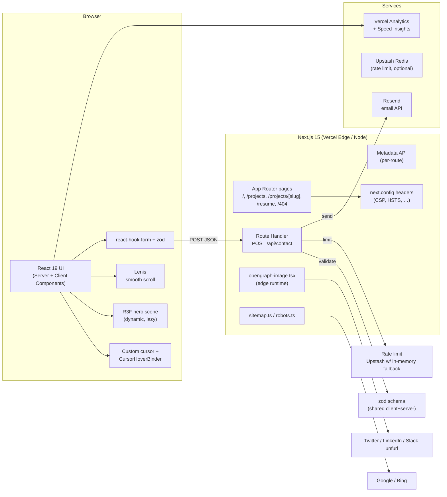

**Why this shape?** Next.js's App Router gives us streaming, Server Components,
and route handlers without a separate API server. Everything important
(validation, rate limit, JSON-LD, metadata) lives *inside the request path*
so there's nothing extra to operate.

---

## 2. Folder structure — "where does what live?"

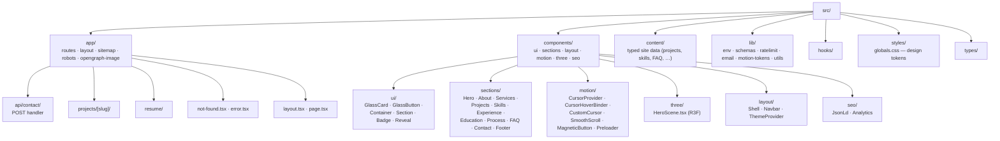

**Rule of thumb:** *components stay content-free.* All copy lives in
`src/content/*.ts`. Want to retune a section? Edit the data file, not the
component.

---

## 3. The request lifecycle — "what happens when someone hits /?"

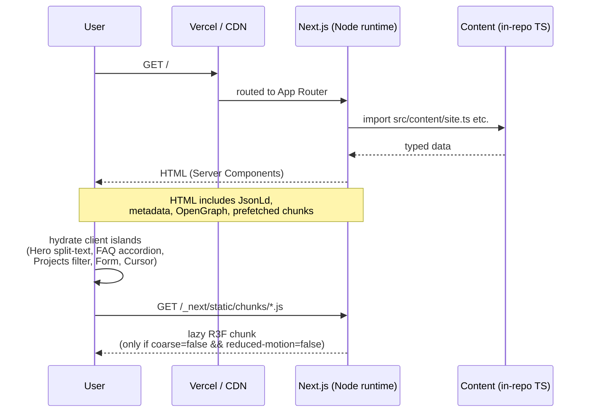

**Performance lever:** the heaviest visual (R3F + Three.js) is `dynamic(..., { ssr: false })`, loaded only after mount, and **gated by client capability checks** (`prefers-reduced-motion`, `(pointer: coarse)`).

---

## 4. The contact form — "how does data actually move?"

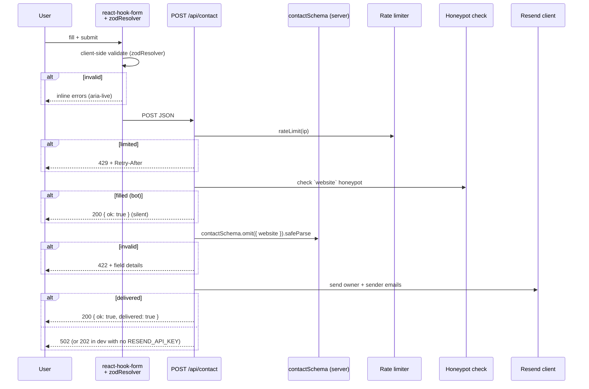

**Security layers, in order:**
1. **Per-IP rate limit** (Upstash in prod, in-memory bucket fallback locally) — 5 req/min.
2. **Honeypot** — a hidden `website` field. Bots fill it; humans don't. Bots that fill it get a silent `200` (no leak).
3. **Server-side zod** — same schema as the client, but the server strips the honeypot first and uses `.omit()` so the schema can't be tricked.
4. **Escape** — every interpolated value in email templates is HTML-escaped (no XSS via the message body).

---

## 5. Design system — "what powers Liquid Glass?"

### 5.1 Design tokens (single source of truth)

All visual values are **CSS variables in `src/styles/globals.css`**, with a
dark default and a `:root[data-theme='light']` override. Tailwind reads them
via `tailwind.config.ts` — components never hard-code colors.

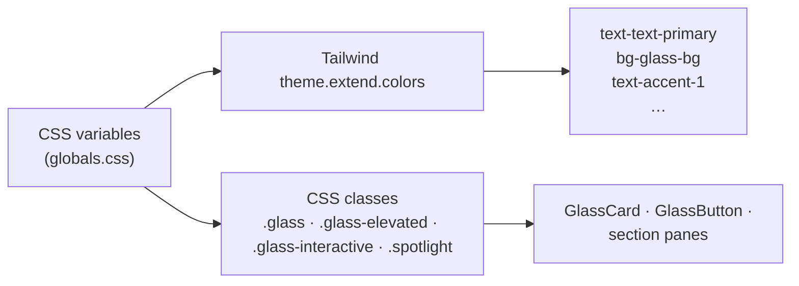

| Group       | Variable                                             | Used for                              |
| ----------- | ---------------------------------------------------- | ------------------------------------- |
| Surfaces    | `--bg-base`, `--bg-elevated`, `--bg-inverse`         | Page background, cards, inverted text |
| Glass       | `--glass-bg`, `--glass-border`, `--glass-highlight`, `--glass-shadow`, `--glass-blur` | Every glass surface |
| Accent      | `--accent-1` (violet), `--accent-2` (cyan)           | CTAs, gradients, spotlight            |
| Text        | `--text-primary`, `--text-secondary`, `--text-muted`, `--text-inverse` | Hierarchy |
| Cursor      | `--cursor-x`, `--cursor-y`, `--cursor-intensity`     | Set globally by CursorProvider        |
| Fonts       | `--font-display`, `--font-sans`, `--font-mono`       | Wired via `next/font` + inline CSS var |

### 5.2 Glass primitive — what makes a card look like glass?

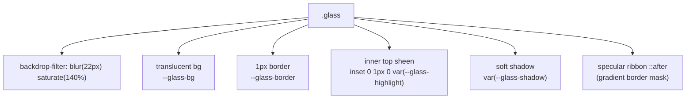

The ribbon is the signature bit: a linear-gradient painted into the
**padding box only** (via `mask-composite: exclude`) so it traces the
border as a highlight without a real second border.

### 5.3 Cursor spotlight — how a single listener lights every card

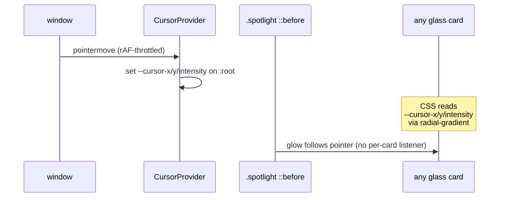

**Why global CSS variables?** No `mousemove` listener per card — that's
O(N) listeners. One global listener, N cards share the state for free.

---

## 6. Motion system — "where do durations and easings come from?"

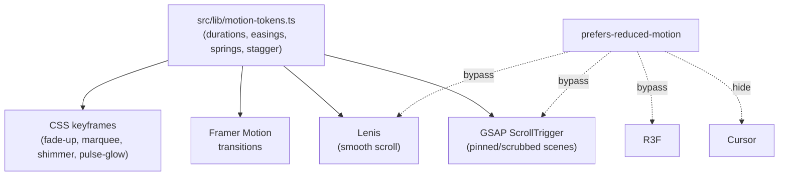

**Three rules enforced by the codebase:**
1. **Never animate `layout` properties** — only `transform`, `opacity`, `filter`.
2. **Nothing over 1.2s** — entrances ease-out, exits faster than entrances.
3. **One source of truth** — every component imports from `motionTokens`. There is no inline `duration: 0.7` anywhere.

**Reduced motion:** the global CSS rule in `globals.css` collapses every
animation/transition to `0.001ms` when the user opts out. Lenis and R3F
also gate themselves client-side.

---

## 7. R3F hero — "why only one WebGL scene?"

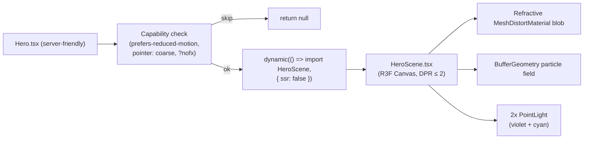

**Trade-offs taken:**
- **One scene, three.js only loaded on capable clients.** Capacitive touch devices and `prefers-reduced-motion` users get a static gradient instead of a 300 kB WebGL dependency.
- **DPR capped at `[1, 2]`** — sharper on retina without melting mobile GPUs.
- **`Suspense fallback={null}`** — avoids a flash of an empty canvas.

---

## 8. SEO & structured data — "what makes Google happy?"

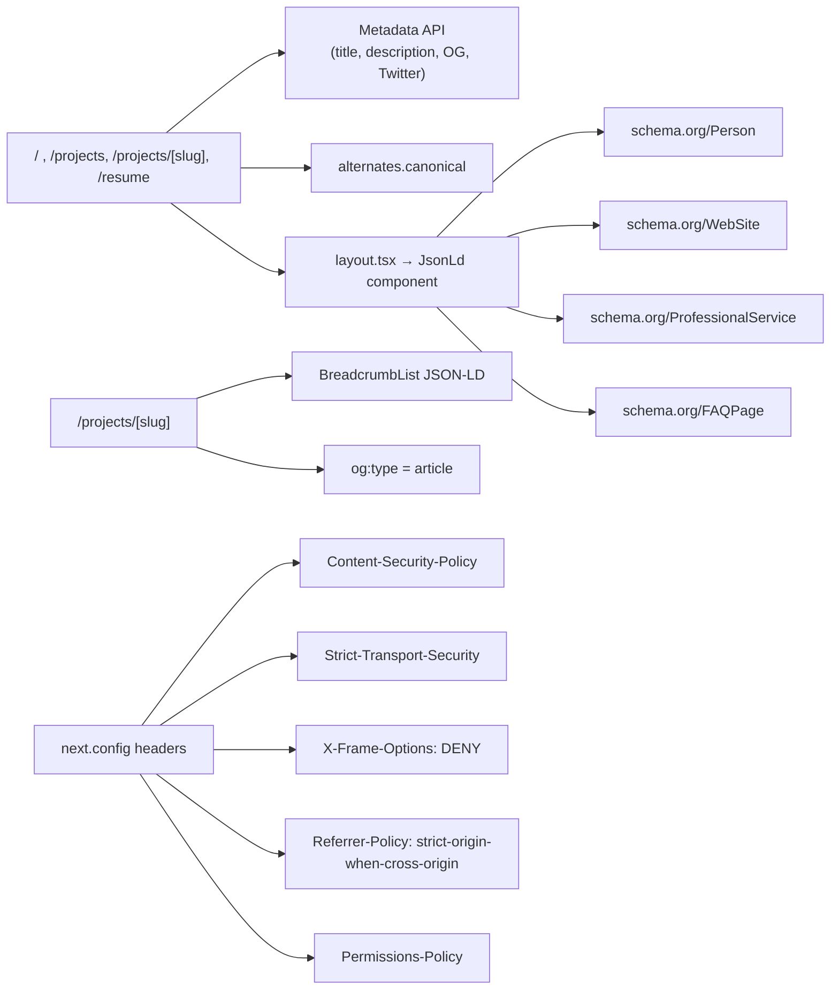

**Sitemap & robots** are *server-rendered* by `src/app/sitemap.ts` and
`src/app/robots.ts` — no separate build step needed.

---

## 9. Performance strategy

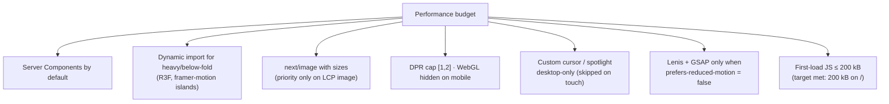

---

## 10. Testing strategy

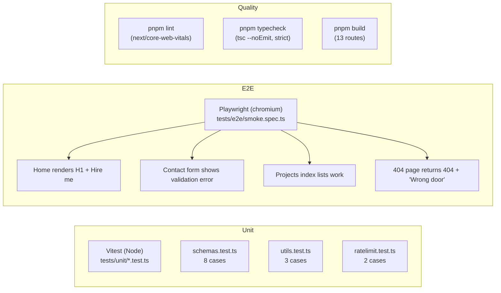

| Layer        | Tool        | What it covers                                       |
| ------------ | ----------- | ---------------------------------------------------- |
| Unit         | Vitest      | zod schema, in-memory rate limit, utility helpers     |
| E2E smoke    | Playwright  | Page renders, navigation, 404 path                   |
| Typecheck    | `tsc --noEmit` | Strict TS, `noUncheckedIndexedAccess`, path aliases |
| Lint         | next lint   | next/core-web-vitals + typescript rules              |
| Build        | next build  | Catches RSC errors, route generation, bundle size     |

---

## 11. Accessibility checklist

- **Skip link** — `.skip-link` jumps to `<main id="main">`.
- **Landmarks** — `<header>`, `<main>`, `<footer>`, `<nav aria-label="Primary">`.
- **Reduced motion** — Lenis/R3F/cursor/animation all bypass when the user opts out.
- **Focus rings** — global `:focus-visible` uses accent color.
- **Form errors** — `aria-live="assertive"` + `role="alert"`.
- **Custom cursor** — `pointer: coarse` skips it entirely; never blocks pointer events.
- **Headings** — one `<h1>` on each page; sections use `<h2>` + `<h3>` (FAQ items).
- **Icons** — every icon-only button has `aria-label`.
- **Filters** — `role="group"` + `aria-pressed` on toggle buttons.
- **FAQ** — `aria-expanded`/`aria-controls` on each button, `role="region"` + `aria-labelledby` on the panel.

---

## 12. Security checklist

- **CSP** — no remote scripts; allowed origins limited to Resend + Upstash + Vercel Insights.
- **HSTS** — `max-age=31536000; includeSubDomains`.
- **X-Frame-Options: DENY** + `frame-ancestors 'none'`.
- **Referrer-Policy: strict-origin-when-cross-origin**.
- **Permissions-Policy** — camera, microphone, geolocation, interest-cohort all disabled.
- **Honeypot + rate limit** on the contact API.
- **HTML-escape** in email templates.
- **No secrets in client bundles** — env is split between `NEXT_PUBLIC_*` (intentional) and server-only.
- **`metadataBase` set** in root layout so OG/Twitter URLs resolve.

---

## 13. Tooling & dev experience

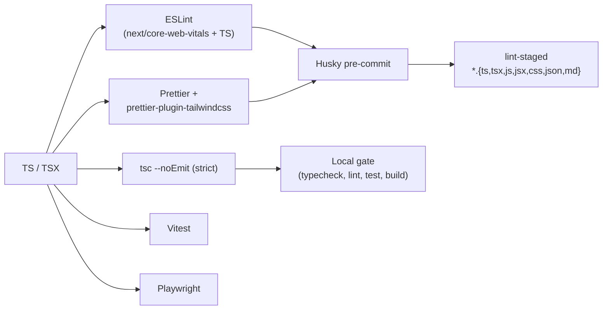

`packageManager: "pnpm@9.15.0"` is set in `package.json` so Corepack pins the
right version. `pnpm` is also wired into `playwright.config.ts` for E2E.

---

## 14. Deployment shape (Vercel)

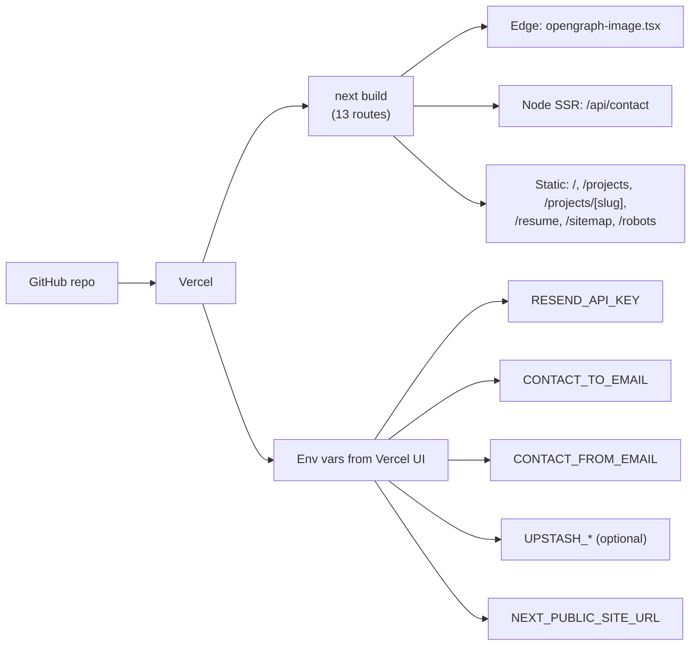

After first deploy: submit `/sitemap.xml` to Google Search Console, verify
the OG image in Twitter's card validator.

---

## 15. "What would you change if you had more time?"

Be honest in the interview — these are the deliberate trade-offs:

1. **Headless CMS** — right now content lives in TS files. For non-dev edits, a Sanity / Contentful schema would be the next step.
2. **Email queue** — Resend failures return 502. For guaranteed delivery, drop in Upstash QStash or pg-boss before the handler.
3. **OG font** — the opengraph-image route uses system sans. Embed Clash Display as a TTF for branded share cards.
4. **Real headshot + screenshots** — currently placeholder rectangles.
5. **Pinned-cards scroll showcase** — the spec mentioned pinned stacked cards for projects; current grid is filterable but not pinned. Easy to add with `gsap.timeline({ scrollTrigger: { scrub: true, pin: true } })`.
6. **i18n** — Dehradun, India is the primary market. Adding `next-intl` for Hindi is a one-afternoon addition.

---

## 16. One-liner per file (for quick recall)

| File                                | What it does in one line                                   |
| ----------------------------------- | ---------------------------------------------------------- |
| `src/app/layout.tsx`                | Root HTML, fonts, metadata base, mounts `AppShell`.         |
| `src/app/page.tsx`                  | Home page composition — every section in order.            |
| `src/app/sitemap.ts`                | Builds `/sitemap.xml` from `projects[]`.                   |
| `src/app/robots.ts`                 | Allow `/`, disallow `/api/`, point at sitemap.             |
| `src/app/opengraph-image.tsx`       | Edge-rendered 1200×630 OG card.                            |
| `src/app/api/contact/route.ts`      | POST handler: rate-limit → honeypot → zod → Resend.        |
| `src/lib/env.ts`                     | zod-validated env, server vs client split.                 |
| `src/lib/schemas.ts`                | Shared `contactSchema`, enums, labels.                     |
| `src/lib/ratelimit.ts`              | Upstash w/ in-memory fallback token bucket + GC.           |
| `src/lib/email.ts`                  | Resend client + HTML/text templates, escaped interpolation.|
| `src/lib/motion-tokens.ts`          | Durations, easings, springs, staggers — single source.      |
| `src/lib/utils.ts`                  | `cn`, `clamp`, `formatRange`, `makeId`, `sleep`.           |
| `src/components/ui/GlassCard.tsx`   | Layered-glass card primitive (default / elevated / interactive). |
| `src/components/ui/GlassButton.tsx` | Button or link primitive (primary / secondary / ghost).   |
| `src/components/ui/Container.tsx`   | Max-width wrapper with editorial gutters.                  |
| `src/components/ui/Section.tsx`     | `<section>` + `SectionHeading` (number + caption + title). |
| `src/components/ui/Reveal.tsx`      | IntersectionObserver fade/translate primitive.             |
| `src/components/ui/Badge.tsx`       | Pill / status indicator.                                   |
| `src/components/layout/Shell.tsx`   | Providers tree, navbar, footer, skip link, grain.           |
| `src/components/layout/Navbar.tsx`  | Sticky glass nav, mobile menu, theme toggle.               |
| `src/components/motion/CursorProvider.tsx` | Tracks pointer, sets `--cursor-x/y/intensity` globally.|
| `src/components/motion/CursorHoverBinder.tsx` | Document-level listener for `[data-cursor]`.       |
| `src/components/motion/CustomCursor.tsx` | Dot + trailing ring, morphs into labelled pill.      |
| `src/components/motion/MagneticButton.tsx` | Wraps children, springs toward cursor within radius. |
| `src/components/motion/SmoothScroll.tsx`   | Lenis + GSAP ScrollTrigger in lockstep.            |
| `src/components/motion/Preloader.tsx`       | One-per-session monogram + glass wipe.             |
| `src/components/three/HeroScene.tsx`        | R3F refractive blob + particles (desktop only).    |
| `src/components/seo/JsonLd.tsx`             | `@graph` JSON-LD (Person/WebSite/Service/FAQ).     |
| `src/components/seo/Analytics.tsx`          | Vercel Analytics + Speed Insights.                 |
| `src/components/sections/*.tsx`             | One component per home section + Footer.           |

---

## 17. Talking points for the interview

Use these as bullet seeds:

- **"Tell me about a recent project"** — this one. Lead with the *problem* (recruiters drop off in <30s, clients need trust within 2min) and the *constraints* (must rank locally, must load on mid-range phones, must work without JS).
- **"How did you keep it fast?"** — Server Components by default, dynamic import for R3F, custom cursor gated to desktop, one global pointer listener for N cards, no layout-property animations.
- **"How do you handle accessibility?"** — reduced-motion bypasses everything heavy; semantic landmarks; form errors are `aria-live`; FAQ uses proper `aria-expanded`/`aria-controls`; icon buttons have `aria-label`.
- **"What about security?"** — CSP + HSTS + XFO + Permissions-Policy in `next.config.ts`; honeypot + rate limit on the form; server-side zod; HTML-escaped email templates.
- **"Why this stack?"** — Next.js 15 RSC + App Router gives us streaming + per-route metadata + route handlers; GSAP for scrubbed scroll storytelling; R3F only where it's worth the cost; Resend for transactional email without a separate service.
- **"What would you do differently?"** — pin-based showcase for projects (current grid is filterable, not pinned), CMS-backed content for non-dev edits, email queue for retries.

Happy interviewing. 🚀